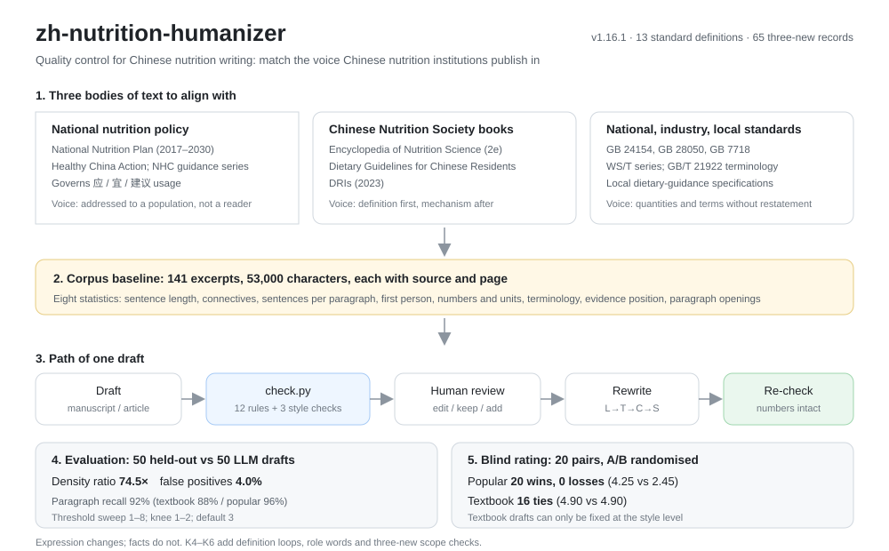

<p align="right"><a href="README.md"></a></p>

<h1 align="center">zh-nutrition-humanizer</h1>

<p align="center"><strong>Voice and style alignment for Chinese nutrition writing</strong></p>
<p align="center">Match the tone of policy documents, learned-society books and standards · zero dependencies · corpus-calibrated thresholds</p>
<p align="center"><strong>v1.0.3 — Writing-Register Wording and SVG Rendering</strong></p>

<p align="center">
  <a href="https://github.com/ChemistryBus/zh-nutrition-humanizer/actions/workflows/validate.yml"></a>
  <a href="https://github.com/ChemistryBus/zh-nutrition-humanizer/releases/tag/v1.0.3"></a>
  <a href="LICENSE"></a>
  
  
</p>



## What it is

Most humanizers chase "sounds like a person". This one chases something else: **the voice Chinese nutrition institutions publish in**.

That voice is not a matter of taste. It is specified by three bodies of text:

<table width="100%">
  <thead><tr><th width="22%">Class</th><th width="44%">Representative texts</th><th width="34%">What it fixes</th></tr></thead>
  <tbody>
    <tr><td>National nutrition policy</td><td>National Nutrition Plan (2017–2030); Healthy China Action; the National Health Commission dietary-guidance series (11 documents, 2023–2026)</td><td>How 应 / 宜 / 不宜 / 建议 are used; addressed to a population, not to a reader</td></tr>
    <tr><td>Chinese Nutrition Society books</td><td><em>Encyclopedia of Nutrition Science</em> (2nd ed.); <em>Dietary Guidelines for Chinese Residents</em> (2022); <em>DRIs</em> (2023)</td><td>Terminology hierarchy, definition style, dose units, where evidence sits relative to a claim</td></tr>
    <tr><td>National, industry and local standards</td><td>GB 24154, GB 28050, GB 7718, the WS/T series, GB/T 21922—2026 terminology, local dietary-guidance specifications</td><td>How quantities are written, unit conventions, terminology and category boundaries</td></tr>
  </tbody>
</table>

What this repository does is turn that voice into measurable features — terminology level, quantity formatting, sentence length, evidence position — and calibrate the thresholds on **141 excerpts, 53,000 characters**. "Does it read right" becomes "how many hits per 1,000 characters", which anyone can check.

It addresses four recurring problems:

- an LLM-written nutrition draft can have every fact and number right and still read like a popular-science account rather than a published document;
- generic "de-AI" advice — delete connectives, split long sentences, add colloquialisms — **lowers the score** on institutional text;
- there is no accepted Chinese AI-detection benchmark, so edits cannot be justified or audited;
- the source corpus is local and copyrighted, so the baseline has to be built from 200–400 character excerpts.

## 30-second start

### Option 1: let an agent install it

Paste this into Claude Code / Codex / DSH:

```text
Ask me first whether zh-nutrition-humanizer may go into my skills directory; only then run:
git clone https://github.com/ChemistryBus/zh-nutrition-humanizer.git ~/.claude/skills/zh-nutrition-humanizer
When done, run python3 scripts/check.py examples/before.md --explain and show me the hit list.
Do not modify my drafts and do not upload any text.
```

### Option 2: manual install

```bash
git clone https://github.com/ChemistryBus/zh-nutrition-humanizer.git
cd zh-nutrition-humanizer
python3 scripts/check.py examples/before.md --explain
```

Zero dependencies, Python 3.10+ (CI covers 3.10 and 3.12); nothing to pip install.

### Try one check first

```bash
python3 scripts/check.py your_draft.md --explain
```

No draft at hand? Use the 20 real drafts shipped with the repo:

```bash
python3 scripts/check.py examples/before.md     # expect: 10.4 hits per 1,000 chars, exit code 1
python3 scripts/check.py examples/after.md      # expect: zero paragraph-level hits
```

## How it judges

Four families: 12 counted rules, 3 document-level style checks, 1 advisory. Every threshold comes from the corpus.

<table width="100%">
  <thead><tr><th width="20%">Family</th><th width="44%">Catches</th><th width="14%">Institution</th><th width="12%">LLM draft</th><th width="10%">Verdict</th></tr></thead>
  <tbody>
    <tr><td>L colloquial (7)</td><td>Chinese numerals with units, second person and imperatives, colloquial adjectives, metaphor nouns, 「像是／好比」, 「不是X而是Y」, evaluative 「更X」 endings</td><td>0–0.03</td><td>0.15–2.0</td><td>fix on sight</td></tr>
    <tr><td>T template (4)</td><td>「其机制在于」, 「而非」, 「亦」, 「宜采用」</td><td>0–0.03</td><td>0.36–1.07</td><td>fix above a density</td></tr>
    <tr><td>C structure (1)</td><td>numeric ranges written with 「至」 instead of ～</td><td>0</td><td>4.52</td><td>always ～</td></tr>
    <tr><td>S style (3)</td><td>mixed units, mixed terminology, missing English gloss</td><td>—</td><td>—</td><td>listed, not scored</td></tr>
  </tbody>
</table>

What a diff looks like (real drafts, numbers untouched):

<table width="100%">
  <thead><tr><th width="12%">Rule</th><th width="44%">Before</th><th width="44%">After</th></tr></thead>
  <tbody>
    <tr><td>L1</td><td>每天蛋白质提高到每公斤体重一点六到二点四克</td><td>蛋白质提高到 1.6～2.4 g/kg</td></tr>
    <tr><td>T1</td><td>其核心依据是能量平衡原则，即摄入能量与总能量消耗相抵</td><td>估算以能量平衡为基础：摄入能量与总能量消耗相抵</td></tr>
    <tr><td>C1</td><td>每日 5 至 7 g/kg/d</td><td>每日 5～7 g/kg/d</td></tr>
  </tbody>
</table>

Full rule table in [`SKILL.md`](SKILL.md) (Chinese); evidence per rule in [`references/rule-audit.md`](references/rule-audit.md); all 20 pairs in [`examples/after.md`](examples/after.md).

## Good fit / bad fit

**Good fit**

- pre-delivery checks on Chinese nutrition, sports-nutrition and dietary-guidance manuscripts;
- checking the manuscript version and the public-article version separately (same content, two registers);
- gatekeeping drafts written by someone else, or by a model.

**Bad fit**

- literary popular science and short-video copy — different register, the L family will over-fire;
- English-only drafts (use academic-humanizer);
- fact checking, citation authenticity, evidence grade versus claim strength — all human work, out of scope.

## Evidence, not an "AI probability"

<table width="100%">
  <thead><tr><th width="30%">Metric</th><th width="46%">Result</th><th width="24%">Target</th></tr></thead>
  <tbody>
    <tr><td>Hit-density ratio</td><td><strong>74.5×</strong> (institution 0.11 vs draft 8.40 per 1,000 chars)</td><td>≥3×</td></tr>
    <tr><td>Paragraph false positives</td><td><strong>4.0%</strong> (2 of 50 authoritative paragraphs flagged)</td><td>&lt;15%</td></tr>
    <tr><td>Paragraph recall</td><td><strong>92%</strong> (textbook 88% / popular 96%)</td><td>—</td></tr>
    <tr><td>Threshold knee</td><td>1–2 per 1,000 chars (J = +0.88); default 3</td><td>—</td></tr>
  </tbody>
</table>

50 held-out authoritative paragraphs (17,755 characters, page ranges disjoint from the baseline) against 50 LLM paragraphs (24 popular, 26 textbook). Per-rule table, threshold sweep, ablation, missed cases and three blind-rating rounds are in [`eval/results.md`](eval/results.md) (Chinese).

Final blind round, on the exact repository text: popular-register rewrites **20 wins, 0 losses** (4.25 vs 2.45); textbook-register pairs are **16 ties** (4.90 vs 4.90). In other words: **a textbook-register AI draft can only be fixed at the style level, not the register level.** That conclusion came from round one, where compressing sentences into telegraph style lost 18 of 18 comparisons.

## Supported harnesses

<table width="100%">
  <thead><tr><th width="30%">Environment</th><th width="70%">Usage</th></tr></thead>
  <tbody>
    <tr><td>CLI / CI</td><td><code>python3 scripts/check.py draft.md --threshold 3</code>; exit code 1 means over threshold</td></tr>
    <tr><td>Claude Code</td><td>clone into <code>~/.claude/skills/</code>; reads <code>SKILL.md</code></td></tr>
    <tr><td>DSH / Cordis</td><td>clone into <code>~/.dsh/skills/</code>; <code>SKILL.md</code> already carries frontmatter</td></tr>
    <tr><td>Custom pipeline</td><td>consume <code>--json</code>; <code>scripts/eval.py</code> works as a regression test</td></tr>
  </tbody>
</table>

## Install options

<table width="100%">
  <thead><tr><th width="30%">Need</th><th width="70%">Do</th></tr></thead>
  <tbody>
    <tr><td>check one draft</td><td>clone and run <code>scripts/check.py</code>; nothing installed</td></tr>
    <tr><td>long-term skill</td><td>clone into the skills directory and pin a tag (<code>git checkout v1.0.3</code>)</td></tr>
    <tr><td>CI gate</td><td>copy <code>scripts/check.py</code> into the repo, or add it as a submodule</td></tr>
  </tbody>
</table>

## FAQ

**Why not delete 「此外／同时」?**
The corpus uses them 3.27 times per 1,000 characters; textbook-register LLM drafts use 3.57. Connectives do not discriminate. What should go is the restatement that follows 「由此可见」.

**Will it ruin good prose?**
Sometimes. The 4.0% false-positive rate is the measured cost on authoritative text, which is why the tool only produces a list and a human decides. No rule touches a number.

**Can it tell whether a text was written by AI?**
No. It reports deviation from this corpus, not an AI probability. There is no accepted Chinese benchmark; anyone claiming one should show their positive and negative samples.

**Why only 200–400 character excerpts?**
Copyright. Every excerpt carries source, publisher and page number; nothing is reproduced in full and no source PDF is redistributed.

**Can I use it in another domain?**
The rule skeleton transfers; the thresholds do not. Rebuild the baseline with `scripts/stats.py` and `scripts/features.py`.

**How is this different from "de-AI" tools?**
Different objective. Those tools make text read like a natural individual — colloquialisms and personal voice are assets. Here the targets are policy documents, learned-society books and standards, where colloquialisms and personal voice are deductions. The same "delete connectives" advice points in opposite directions under the two objectives.

## Documents

<table width="100%">
  <thead><tr><th width="34%">File</th><th width="66%">Content</th></tr></thead>
  <tbody>
    <tr><td><a href="SKILL.md">SKILL.md</a></td><td>the skill: positioning, rule table, workflow, limitations (Chinese)</td></tr>
    <tr><td><a href="references/baseline.md">references/baseline.md</a></td><td>eight statistics over 141 excerpts, extraction routing, reproduction (Chinese)</td></tr>
    <tr><td><a href="references/rule-audit.md">references/rule-audit.md</a></td><td>all 25 v0.1 rules audited: 17 deleted, 5 merged, 4 kept, 2 unverified (Chinese)</td></tr>
    <tr><td><a href="references/ai-tells.md">references/ai-tells.md</a></td><td>before/after table by rule id, plus seven "do not change" cases (Chinese)</td></tr>
    <tr><td><a href="eval/results.md">eval/results.md</a></td><td>evaluation report: density, false positives, sweep, misses, blind ratings (Chinese)</td></tr>
    <tr><td><a href="examples/after.md">examples/after.md</a></td><td>20 real drafts and rewrites, numbers untouched (Chinese)</td></tr>
    <tr><td><a href="THIRD_PARTY_NOTICES.md">THIRD_PARTY_NOTICES.md</a></td><td>corpus sources and copyright</td></tr>
  </tbody>
</table>

## Licence

Code is MIT, see [`LICENSE`](LICENSE). Corpus excerpts are outside the MIT grant; sources and copyright are listed in [`THIRD_PARTY_NOTICES.md`](THIRD_PARTY_NOTICES.md).
