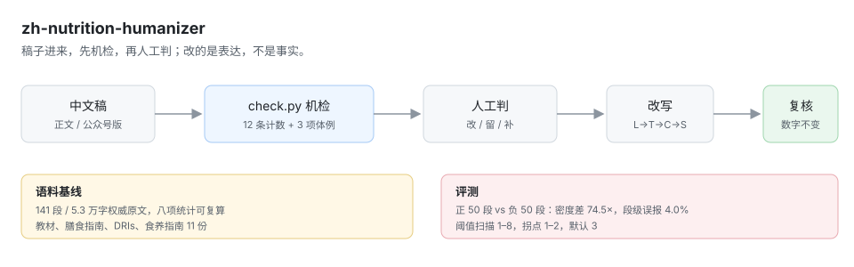

<p align="right"><a href="README.en.md"></a></p>

<h1 align="center">zh-nutrition-humanizer</h1>

<p align="center"><strong>中文营养写作的润色与术语校订</strong></p>
<p align="center">对齐政策文件、学会出版物与标准的口吻 · 润色语言，校订术语 · 零依赖</p>
<p align="center"><strong>v1.2.0 — Deterministic Polishing</strong></p>

<p align="center">
  <a href="https://github.com/ChemistryBus/zh-nutrition-humanizer/actions/workflows/validate.yml"></a>
  <a href="https://github.com/ChemistryBus/zh-nutrition-humanizer/releases/tag/v1.2.0"></a>
  <a href="LICENSE"></a>
  
  
  
</p>



## 它是什么

humanizer 大多在追「像人写的」。这里追的是另一件事：**中文营养界公开发布文字时的口吻**。

这个口吻不是一种抽象的风格偏好，它由三类文本具体定义：

<table width="100%">
  <thead><tr><th>类别</th><th>代表文本</th><th>它定下了什么</th></tr></thead>
  <tbody>
    <tr><td>国家营养政策文件</td><td>《国民营养计划（2017—2030 年）》、健康中国行动、国家卫生健康委员会食养指南系列（11 份，2023–2026）</td><td>「建议、应、宜、不宜」的用法；面向人群而非面向读者个人</td></tr>
    <tr><td>中国营养学会出版物</td><td>《中国营养科学全书（第 2 版）》、《中国居民膳食指南（2022）》、《中国居民膳食营养素参考摄入量（DRIs，2023）》</td><td>术语层级、定义写法、剂量单位、论断与依据的相对位置</td></tr>
    <tr><td>国家 / 行业 / 地方标准</td><td>GB 24154、GB 28050、GB 7718、WS/T 系列、GB/T 21922—2026 术语标准、地方食养与配餐规范</td><td>量的写法、单位体例、术语与分类边界</td></tr>
    <tr><td colspan="3" width="1200">三类文本并列而非替代：政策文件定口吻，学会出版物定术语与定义，标准定量与单位的写法。</td></tr>
  </tbody>
</table>

本仓库做的，是把这三类文本拆成可测的指标——术语层级、剂量写法、句式长度、依据位置——再用 **141 段、5.3 万字**的语料校准阈值。所以「像不像」不是谁说了算，而是能落到「每千字几次」上。

它主要解决四类问题：

- 大模型写营养稿，事实与数字都对，但口吻不对：像科普号，不像公开发布的文件；
- 「去 AI 味」的通用技巧（删连接词、拆长句、加口语）用在机构文本上会**反向降分**；
- 中文没有公认的 AI 检测标准，凭感觉改，改完没法复核；
- 语料在本地、版权不能整本转载，只能靠 200–400 字摘录建基线。

## 30 秒开始

### 方式一：让 agent 帮你装

把下面这段发给 Claude Code / Codex / DSH：

```text
请先问我是否允许把 zh-nutrition-humanizer 放进技能目录，得到允许后再执行：
git clone https://github.com/ChemistryBus/zh-nutrition-humanizer.git ~/.claude/skills/zh-nutrition-humanizer
安装完成后运行 python3 scripts/check.py examples/before.md --explain，把命中清单给我。
不要改动我的稿子，也不要上传任何文本。
```

### 方式二：手动安装

```bash
git clone https://github.com/ChemistryBus/zh-nutrition-humanizer.git
cd zh-nutrition-humanizer
python3 scripts/check.py examples/before.md --explain
```

零依赖，Python 3.10+（CI 覆盖 3.10 与 3.12），不需要 pip 装任何东西。

### 先让机器做确定性改动

```bash
python3 scripts/polish.py 你的稿子.md          # 输出 稿子.polished.md，并列出每处改动
```

只改五类：术语误写、数值区间「至」、汉字数字带单位、术语层级、多余空格。
引号里的原文不动，数字只做写法转换（三百毫克 → 300 mg），不做同义改写。

### 再跑一次机检

```bash
python3 scripts/check.py 你的稿子.md --explain
```

没有稿子？用仓库自带的 20 组真实初稿：

```bash
python3 scripts/check.py examples/before.md     # 预期：10.4 处/千字，退出码 1
python3 scripts/check.py examples/after.md      # 预期：段落级 0 命中（说明性文字除外）
```

## 怎么判

五族规则：L/T/C 是语体与结构（12 条），K 是术语（14 条错误写法，覆盖 11 个术语），S 是文档级体例（3 项）。

<table width="100%">
  <thead><tr><th>族</th><th>抓什么</th><th>机构文本</th><th>大模型初稿</th><th>判法</th></tr></thead>
  <tbody>
    <tr><td>L 口语降维（7 条）</td><td>汉字数字带单位、第二人称与祈使、口语形容、比喻实体词、像是／好比、不是X而是Y、更X收尾</td><td>0–0.03</td><td>0.15–2.0</td><td>出现即改</td></tr>
    <tr><td>T 模板化（4 条）</td><td>其机制在于、而非、亦、宜采用</td><td>0–0.03</td><td>0.36–1.07</td><td>超过密度才改</td></tr>
    <tr><td>C 结构（1 条）</td><td>数值区间用“至”</td><td>0</td><td>4.52</td><td>一律改 ～</td></tr>
    <tr><td>K 术语（14 条）</td><td>维他命、粗纤维、必要氨基酸、碳水化合物就是糖、脂肪即脂类、营养成分就是营养素……</td><td>0</td><td>视稿件</td><td>命中即改，依据为标准原文</td></tr>
    <tr><td>S 体例（3 项）</td><td>单位混用、术语混用、首现未给英文</td><td>—</td><td>—</td><td>逐条列出，不计密度</td></tr>
    <tr><td colspan="5" width="1200">每千字为实测值：L 族在机构文本里为 0，T 族有少量正当用法，所以按密度判；K 族是确定性错误，命中即改。</td></tr>
  </tbody>
</table>

### 改前改后

真实初稿，数字不动；20 组完整对照见 [`examples/after.md`](examples/after.md)。

<table width="100%">
  <thead><tr><th>规则</th><th>改前</th><th>改后</th></tr></thead>
  <tbody>
    <tr><td>L1</td><td>每天蛋白质提高到每公斤体重一点六到二点四克</td><td>蛋白质提高到 1.6～2.4 g/kg</td></tr>
    <tr><td>T1</td><td>其核心依据是能量平衡原则，即摄入能量与总能量消耗相抵</td><td>估算以能量平衡为基础：摄入能量与总能量消耗相抵</td></tr>
    <tr><td>C1</td><td>每日 5 至 7 g/kg/d</td><td>每日 5～7 g/kg/d</td></tr>
    <tr><td colspan="3" width="1200">20 组完整对照在 examples/after.md；改写不动数字、单位与证据等级。</td></tr>
  </tbody>
</table>

### 术语与定义怎么查

`references/terms.json` 收录 22 条术语，其中 16 条的定义**逐字引自标准原文**
（GB 28050—2025 §2 共 13 条、GB 13432—2013 §2 共 3 条），其余只收名称与英文，`needs_definition` 标出，不凭记忆补写。

<table width="100%">
  <thead><tr><th>查什么</th><th>怎么查</th><th>能不能自动改</th></tr></thead>
  <tbody>
    <tr><td>写法错误</td><td>术语表里的错误形式：维他命、粗纤维、必要氨基酸</td><td>能，给出标准写法</td></tr>
    <tr><td>定义错误</td><td>「碳水化合物就是糖」「脂肪即脂类」「营养成分就是营养素」这类方向反了的包含关系</td><td>能，附标准定义与条款号</td></tr>
    <tr><td>定义句待核</td><td>正文出现「X 是指／定义为」时，把标准定义摆出来供比对</td><td>不自动改，人比对</td></tr>
    <tr><td>层级与口径</td><td>同篇混用（碳水／糖类、脂肪／脂类、能量／热量、GI／升糖指数）</td><td>只报，由人判</td></tr>
    <tr><td colspan="3" width="1200">缺口：GB/T 21922—2026 与 GB 28050 引用的 GB/Z 21922 均未入库，涉及它们的术语只能标「待核」。</td></tr>
  </tbody>
</table>

完整规则表见 [`SKILL.md`](SKILL.md)，每条的依据见 [`references/rule-audit.md`](references/rule-audit.md)。

## 适合 / 不适合

**适合**

- 中文营养、运动营养、食养类稿件的交付前检查；
- 书稿正文与公众号版分别过一遍（同一内容，两种语体）；
- 别人或大模型写的稿子要进项目，先过这道门。

**不适合**

- 文学性科普、短视频文案——那是另一套语体，L 族规则会大面积误伤；
- 纯英文稿（用 academic-humanizer）；
- 事实核查、引用真伪、证据等级与论断强度是否匹配——这三项必须人看，机检不碰。

## 证据，不是「AI 概率」

<table width="100%">
  <thead><tr><th>指标</th><th>结果</th><th>目标</th></tr></thead>
  <tbody>
    <tr><td>命中密度差</td><td><strong>74.5×</strong>（机构 0.11 vs 初稿 8.40 处/千字）</td><td>≥3×</td></tr>
    <tr><td>段级误报率</td><td><strong>4.0%</strong>（2/50 段权威原文被标）</td><td>&lt;15%</td></tr>
    <tr><td>段级召回</td><td><strong>92%</strong>（教材体 88% / 科普体 96%）</td><td>—</td></tr>
    <tr><td>阈值拐点</td><td>1–2 处/千字（J=+0.88），默认取 3</td><td>—</td></tr>
    <tr><td colspan="3" width="1200">指标定义与复算命令见 eval/results.md；漏报 4/50 的个案分析在同一文件第 7 节。</td></tr>
  </tbody>
</table>

正样本 50 段（1.78 万字，与建基线的页码不重叠）、负样本 50 段（科普体 24 / 教材体 26）。逐规则表、阈值曲线、消融、漏报分析与三轮盲评在 [`eval/results.md`](eval/results.md)。

盲评最终轮（与仓库文本逐字一致）：科普体改写 **20 胜 0 负**（4.25 vs 2.45），教材体 **16 平**（4.90 vs 4.90）——**教材体 AI 稿只能改体例，改不动语体**。这句是三轮盲评打出来的，第一轮我因为把句子压成电报句被判负 18 次。

## 支持哪些 harness

技能目录放对，`SKILL.md` 自带 frontmatter，不需要改配置。

<table width="100%">
  <thead><tr><th>环境</th><th>技能目录</th><th>说明</th></tr></thead>
  <tbody>
    <tr><td>纯命令行 / CI</td><td>—</td><td><code>python3 scripts/check.py 稿子.md --threshold 3</code>，退出码 1 即超阈值</td></tr>
    <tr><td>Claude Code</td><td><code>~/.claude/skills/</code></td><td>整目录复制，读 <code>SKILL.md</code></td></tr>
    <tr><td>Codex</td><td><code>~/.codex/skills/</code></td><td>同上；技能多时在对话里点名 <code>zh-nutrition-humanizer</code></td></tr>
    <tr><td>DSH（DeepSeek Harness）</td><td><code>~/.dsh/skills/</code></td><td>同上，frontmatter 已就绪</td></tr>
    <tr><td>ZCode</td><td><code>~/.zcode/skills/&lt;skill-name&gt;/SKILL.md</code></td><td>用户级目录，目录名即技能名</td></tr>
    <tr><td>Kimi CLI</td><td><code>~/.kimi/skills/</code> 或 <code>~/.config/agents/skills/</code></td><td>后者为共享目录，多个 harness 可共用一份</td></tr>
    <tr><td>MiniMax</td><td><code>~/.agents/skills/</code> 或 <code>~/.config/minimax/skills</code></td><td>项目级可放 <code>.agents/skills</code></td></tr>
    <tr><td>WorkBuddy</td><td><code>~/.workbuddy/skills/</code></td><td>项目级用 <code>.codebuddy/skills/</code>（沿用 CodeBuddy 内核的目录名）</td></tr>
    <tr><td>自建流程</td><td>—</td><td><code>--json</code> 输出喂给下游；<code>scripts/eval.py</code> 可接入回归测试</td></tr>
    <tr><td colspan="3" width="1200">目录以各 harness 官方文档为准；本表按 2026 年 11 月的约定整理。</td></tr>
  </tbody>
</table>

目录名以各 harness 官方文档为准；上表按 2026-11 的实际目录约定整理，版本升级后若目录变动，以文档为准。

## 安装选项

<table width="100%">
  <thead><tr><th>需求</th><th>做法</th></tr></thead>
  <tbody>
    <tr><td>只想查一篇稿子</td><td><code>git clone</code> 后直接跑 <code>scripts/check.py</code>，不安装</td></tr>
    <tr><td>当技能长期用</td><td>克隆到技能目录，版本用 tag 锁（<code>git checkout v1.2.0</code>）</td></tr>
    <tr><td>接进 CI</td><td>把 <code>scripts/check.py</code> 拷进仓库，或 <code>git submodule add</code></td></tr>
    <tr><td colspan="2" width="1200">安装不需要 pip；长期使用建议锁 tag，升级后重跑 scripts/validate.py。</td></tr>
  </tbody>
</table>

## 常见问题

**Q：为什么不删「此外／同时」？**
机构文本 3.27 处/千字，大模型教材体 3.57，删连接词不是判别特征。要删的是「由此可见」后面那句复述。

**Q：会不会把好文字改坏？**
会。误报率 4% 就是对权威原文的实测误伤；所以机检只出清单，改不改由人判，规则里也没有一条会动数字。

**Q：能判断一段话是不是 AI 写的吗？**
不能。这里给的是「相对于本语料的偏离度」，不是 AI 概率。中文没有公认的检测基准，任何声称能判的都要看它的正负样本。

**Q：为什么语料只有 200–400 字摘录？**
版权。每段标注来源、出版方、页码，只用于统计与对照，不整本转载；原始 PDF 不入库。

**Q：能用在别的领域吗？**
规则骨架可以，阈值不行。换领域必须重建基线——`scripts/stats.py` 与 `scripts/features.py` 就是干这个的。

**Q：为什么叫 humanizer？**
英文里 humanizer 指把机器文本改得像人写的工具。这里沿用这个词，但目标是反的：不是让它像自然人，而是让它像机构发布的文字。中文标题用「语体校准」，比「人味化」准确。

**Q：术语写错了能改吗？**
能改**已知的错**：维他命→维生素、粗纤维→膳食纤维、必要氨基酸→必需氨基酸，以及「碳水化合物就是糖」「脂肪即脂类」这类方向反了的定义。依据是 `references/terms.json`：22 条术语，16 条定义逐字引自标准原文（GB 28050—2025 §2 共 13 条、GB 13432—2013 §2 共 3 条）。
不能判**未知的对错**：术语表没收的写法，只报「同篇混用」；涉及 GB/T 21922—2026 的条目一律标「待核」，因为标准原文没入库。

**Q：和「去 AI 味」的工具有什么不同？**
目标不同。那类工具让文字更像自然人写作，允许口语与个人声音；这里要求更像政策文件、学会出版物与标准，口语与个人声音恰恰是减分项。同一个「删连接词」在这两套目标下结论相反。

## 文档

<table width="100%">
  <thead><tr><th>文件</th><th>内容</th></tr></thead>
  <tbody>
    <tr><td><a href="SKILL.md">SKILL.md</a></td><td>技能主文件：定位、规则表、流程、局限</td></tr>
    <tr><td><a href="references/baseline.md">references/baseline.md</a></td><td>141 段语料的八项统计、提取路由、复现方法</td></tr>
    <tr><td><a href="references/rule-audit.md">references/rule-audit.md</a></td><td>v0.1 的 25 条规则逐条判（删 17、并 5、留 4、待验证 2）</td></tr>
    <tr><td><a href="references/ai-tells.md">references/ai-tells.md</a></td><td>按规则编号排的对照表 + 七条「什么时候不该改」</td></tr>
    <tr><td><a href="eval/results.md">eval/results.md</a></td><td>评测报告：密度差、误报率、阈值扫描、漏报、盲评</td></tr>
    <tr><td><a href="examples/after.md">examples/after.md</a></td><td>20 组真实初稿与改写，数字零改动</td></tr>
    <tr><td><a href="references/terms.json">references/terms.json</a></td><td>22 条术语；16 条定义逐字引自 GB 28050—2025（13 条）与 GB 13432—2013（3 条）</td></tr>
    <tr><td><a href="CONTRIBUTORS.md">CONTRIBUTORS.md</a></td><td>作者与致谢：人做什么、工具做什么、署名怎么留痕</td></tr>
    <tr><td><a href="THIRD_PARTY_NOTICES.md">THIRD_PARTY_NOTICES.md</a></td><td>语料来源与版权声明</td></tr>
    <tr><td colspan="2" width="1200">除 README.en.md 与 THIRD_PARTY_NOTICES.md 外，文档正文均为中文。</td></tr>
  </tbody>
</table>

## 作者与致谢

本项目由 **ChemistryBus** 发起并终审，**DSH（DeepSeek Harness）** 执行语料抽取、规则实现、评测与文档初稿。
每个提交都带 `Co-Authored-By: DSH (DeepSeek Harness)`，在提交列表里显示为第二个头像；
GitHub 的 Contributors 图按「提交作者绑定的账号」统计，DSH 没有账号，也不为此注册——
分工与核对方式写在 [`CONTRIBUTORS.md`](CONTRIBUTORS.md)。

## 许可

代码 MIT，见 [`LICENSE`](LICENSE)。语料摘录不在 MIT 授权范围内，来源与版权见 [`THIRD_PARTY_NOTICES.md`](THIRD_PARTY_NOTICES.md)。
